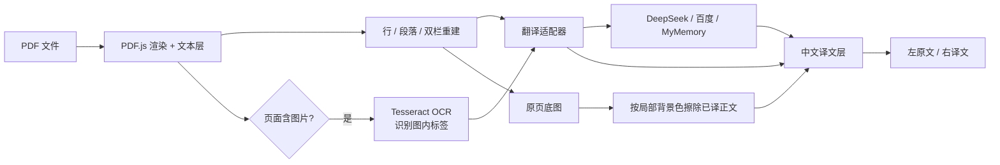

[README.md](https://github.com/user-attachments/files/34325935/README.md)
<p align="center">
  
</p>

<h1 align="center">译镜 · Paper Mirror</h1>

<p align="center">
  在 Edge / Chrome 打开英文 PDF，点击工具栏图标，得到一份<strong>左边原文、右边译文</strong>的对照文档。<br>
  译文跟着原文的版式走，图表、公式和表格线留在原位。
</p>

<p align="center">
  
  
  
  
  
</p>

<p align="center">
  <a href="../../releases/latest">下载最新版</a> ·
  <a href="paper-mirror/README.md">完整使用说明</a> ·
  <a href="#工作原理">工作原理</a> ·
  <a href="#已知限制">已知限制</a>
</p>

---

## 为什么叫「译镜」

原文在左，译文在右，同一页、同一位置，像照镜子。

普通的 PDF 翻译工具通常把文字抽出来重新排版，图表、公式和分栏会丢失。译镜做的是另一件事：**尽量保留原文的版面，只把文字换成中文**。所以左边是原文，右边是同一张纸的“中文镜像”。

---

## 功能

| 功能 | 说明 |
| --- | --- |
| **左右对照** | 左侧原版 PDF，右侧同尺寸译文页；段落、标题、分栏、脚注按原坐标重排 |
| **图表不丢** | 以原页面为底图，只擦除已翻译的正文；图表、公式、表格线、页眉页脚保留 |
| **图内标签 OCR** | 图片里的英文标签用本地 Tesseract 识别，在原位置替换成中文，方框和连线不变 |
| **参考文献跳过** | 自动识别 References / Bibliography，默认不翻译，节省约 20–30% token |
| **双栏识别** | 自动识别论文双栏排版，在栏缝处切分，避免左右栏文字被合并 |
| **表格保护** | 数字占比高的表格行保留原文，避免白底覆盖表格线和数据 |
| **多种翻译服务** | DeepSeek、硅基流动、智谱 GLM、Moonshot、OpenAI、百度翻译、MyMemory、自定义 |
| **免费方案** | 百度翻译有免费额度；MyMemory 无需 Key，适合短文档试用 |
| **翻译缓存** | 同一段文字只翻译一次，重新打开同一篇不重复计费 |
| **交互** | 悬停译文高亮原文、对照/原文/译文切换、页码跳转、缩放、Ctrl+滚轮 |
| **失败恢复** | 接口报错保留已完成页面，支持继续翻译和单页重试 |

---

## 快速开始

### 直接安装

1. 从 [Releases](../../releases/latest) 下载 `paper-mirror-v0.2.1.zip`，或直接下载仓库里的 [paper-mirror-v0.2.1.zip](paper-mirror-v0.2.1.zip)。
2. 解压到固定目录。
3. Edge 打开 `edge://extensions`，Chrome 打开 `chrome://extensions`。
4. 开启 **开发人员模式 / 开发者模式**。
5. 点击 **加载解压缩的扩展 / 加载已解压的扩展程序**，选择 `paper-mirror` 文件夹（含 `manifest.json`）。
6. 建议把「译镜」固定到工具栏。

> Chrome 137+ 只是禁用了命令行加载参数；手动“加载已解压的扩展程序”仍然可用。
>
> 如果要打开本地 PDF，请在扩展详情页开启 **允许访问文件网址 / 允许访问文件 URL**。

### 从源码加载

```text
下载/克隆仓库
        ↓
edge://extensions 或 chrome://extensions
        ↓
开发者模式 → 加载已解压的扩展程序
        ↓
选择 paper-mirror/ 目录
```

无需构建、无需 npm install，源码即扩展。

---

## 配置翻译服务

首次安装会自动打开设置页，也可以右键扩展图标 → **选项**。

### 推荐：DeepSeek

1. 打开 <https://platform.deepseek.com/api_keys> 创建 API Key。
2. 设置页选择 **DeepSeek**，粘贴 Key。
3. 点击 **测试连接** → **保存设置**。

DeepSeek 中文质量好、价格低，翻译一篇 20 页论文通常只需几分钱到几毛钱。

### 百度翻译（免费额度）

1. 在 <https://fanyi-api.baidu.com/> 创建“通用文本翻译”应用。
2. 设置页选择 **百度翻译**，填写 **AppID** 和 **密钥**。
3. 测试连接后保存。

百度标准版有免费额度，但 QPS 较低；扩展已做请求节流。具体额度以百度官网为准。

### MyMemory（无需 Key）

设置页选择 **MyMemory**，直接测试连接并保存即可。

免费公共接口，无需密钥，但每天字符数有限、速度较慢，适合短文档或试用；长论文可能触发限额。

### 其他服务

| 服务商 | 默认模型 | 说明 |
| --- | --- | --- |
| DeepSeek | `deepseek-chat` | 推荐，性价比高 |
| 硅基流动 | `Qwen/Qwen2.5-7B-Instruct` | 国内可访问，可换免费模型 |
| 智谱 GLM | `glm-4-flash` | 有免费额度 |
| Moonshot | `moonshot-v1-8k` | 长文本稳定 |
| OpenAI | `gpt-4o-mini` | 需要可访问 OpenAI 的网络 |
| 百度翻译 | 通用文本翻译 API | 需要 AppID/密钥，有免费额度 |
| MyMemory | 公共接口 | 无需 Key，限额较低 |
| 自定义 | 自行填写 | 任意 OpenAI 兼容 `/chat/completions` 服务 |

**大模型接口要求**：`Base URL + /chat/completions`，`Authorization: Bearer <API Key>`，返回 `choices[0].message.content`，模型需按 JSON 数组输出译文。

---

## 使用

1. 浏览器直接打开英文 PDF（arXiv、期刊直链、本地文件均可）。
2. 点击工具栏「译镜」图标（PDF 标签页会显示 `PDF` 角标）。
3. 扩展打开双语阅读页：
   - **左**：原文 PDF；
   - **右**：按原文坐标排版的中文译文。
4. 顶栏可以切换 **对照 / 原文 / 译文**、翻页、缩放、停止/继续翻译。
5. 鼠标悬停右侧译文：左侧原文对应位置高亮；被压缩的译文可悬停查看完整中文。
6. 右键 PDF 链接，也有 **用「译镜」翻译此 PDF**。

**设置项说明**：

- **翻译参考文献**：默认关闭。识别到 References / Bibliography 后，后续页面不再送翻译；右侧会显示“参考文献页 · 已跳过翻译”。
- **识别图片里的英文（OCR）**：默认开启。只对含图片的页面运行，会增加处理时间。
- **保留图表与公式**：默认开启。关闭后右侧变成纯文字页，不显示原图底图。
- 参考文献/OCR 开关修改后，需要重新打开文献或重新翻译才会生效。

---

## 工作原理



1. **PDF.js** 渲染每一页，同时读取文字层的坐标、字号和粗体。
2. 按基线聚成行，再按行距、缩进、字号合并成段落；识别双栏时在栏缝处强制切分。
3. 过滤页码、页眉页脚、公式碎片和数字占比很高的表格行。
4. 含图片的页面额外运行 **Tesseract OCR**：先把 PDF 文字层抹白，只识别图片/矢量轮廓里的标签。
5. 段落和图内标签分批发送给翻译服务。
6. 右侧同尺寸纸面上：正文按原坐标排版，放不下时自动缩小字号；图内标签按标签框取局部背景色覆盖原文，再写中文。
7. 以原页面为底图，保留图表、公式、表格线和颜色；只替换已翻译的文字区域。
8. 译文和 OCR 结果写入本地缓存，重复打开不重复请求。

---

## 项目结构

```text
.
├─ README.md                    # 本文件（GitHub 首页）
├─ docs/banner.png              # 项目横幅
├─ paper-mirror/                # 扩展源码
│  ├─ manifest.json
│  ├─ background.js
│  ├─ viewer.html/css/js        # 双语阅读器
│  ├─ options.html/css/js       # 设置页
│  ├─ config.js
│  ├─ lib/                      # PDF.js、Tesseract、MD5
│  ├─ tessdata/                 # 英文 OCR 语言包
│  ├─ cmaps/                    # PDF 字符映射
│  ├─ standard_fonts/           # PDF.js 标准字体
│  └─ README.md                 # 完整使用说明
└─ paper-mirror-v0.2.1.zip      # 可直接安装的扩展包
```

> 建议把 zip 作为 GitHub **Release** 附件，而不是长期提交在仓库里；README 已同时提供 Releases 和仓库内文件两种下载方式。

---

## 隐私与权限

- **API Key / 百度 AppID / 密钥只保存在本机** `chrome.storage.local`，不会上传到本项目作者的服务器（本项目没有服务器）。
- **翻译文字会发送给你选择的翻译服务商**；百度翻译、MyMemory 等第三方服务有自己的日志和限额政策。
- **图内 OCR 在本机完成**，图片不会上传；但 OCR 出的文字会随正文一起发送给翻译服务。
- 扩展不收集统计数据，不注入远程脚本；PDF.js、Tesseract 和语言包都随扩展本地打包。

| 权限 | 用途 |
| --- | --- |
| `storage` | 保存设置、译文缓存、OCR 缓存 |
| `tabs` | 读取当前标签页地址、打开阅读页 |
| `scripting` / `activeTab` | 在网页中查找嵌入的 PDF |
| `contextMenus` | 右键菜单“用译镜翻译此 PDF” |
| `<all_urls>` | 下载任意站点的 PDF、访问你配置的翻译接口 |

---

## 已知限制

- **图内 OCR 是尽力而为**：字号太小、旋转、低对比度或被线条穿插的标签可能漏识别，漏掉的会保留英文原文。
- **扫描版 PDF 可以尝试，但质量有限**：没有文字层的扫描件会整页 OCR，按行替换，阅读体验不如原生 PDF 文本。
- **表格数据默认保留英文**：数字占比高的表格行不翻译，避免擦除表格线和数据；表头/表注可能部分翻译。
- **公式不翻译**：公式和数学符号保留原文（右侧底图中可见），避免译文破坏公式。
- **版式是重排，不是像素级还原**：长译文会自动缩小字号，个别段落位置可能与原文略有差异。
- **部分出版社可能下载失败**：登录、防盗链、Cloudflare 等会阻止扩展直接抓取；可先下载到本地再打开。
- **免费服务有额度限制**：百度有免费额度但 QPS 低；MyMemory 每天字符数有限、速度慢，机器翻译质量低于大模型。

---

## Roadmap

- [x] 左右双语对照与版式重建
- [x] 双栏识别、表格数据保护
- [x] 图表/公式底图保留
- [x] 图内标签 OCR 原位翻译
- [x] 参考文献跳过开关
- [x] 百度翻译 / MyMemory 适配器
- [ ] OCR 多尺度/裁切识别，提升小标签召回
- [ ] 旋转标签、纯矢量轮廓文字
- [ ] 表格文字原位翻译
- [ ] 导出双语 PDF
- [ ] 扫描版 PDF 的段落级 OCR
- [ ] 英文界面 / i18n
- [ ] Chrome Web Store / Edge Add-ons 上架

---

## 开发

- 无构建步骤，修改源码后到扩展管理页点 **重新加载** 即可。
- 已在 **Edge 156 / Chrome 156** 上测试；15 页单栏论文与 12 页双栏论文的所有页面 0 译文溢出、0 重叠。
- 核心文件：
  - `paper-mirror/viewer.js`：PDF 渲染、文本块重建、OCR、翻译、底图合成；
  - `paper-mirror/options.js`：服务商配置与测试连接；
  - `paper-mirror/config.js`：默认设置和服务商预设；
  - `paper-mirror/lib/tesseract/`：本地 OCR 引擎与 wasm；
  - `paper-mirror/lib/md5.js`：百度签名。
- Manifest V3 的 CSP 包含 `'wasm-unsafe-eval'`，用于本地 Tesseract wasm。
- 测试时建议使用无敏感内容的公开论文；不要提交 API Key。

---

## 贡献

欢迎提 Issue / PR，尤其是：

- 某类 PDF 的版式错位、段落合并问题；
- 图内 OCR 漏识别或误识别；
- 新的 OpenAI 兼容服务商 / 免费翻译接口；
- 界面和交互改进。

提 Issue 时请附上：PDF 来源（或截图）、复现步骤、浏览器版本、控制台报错。**不要贴 API Key。**

---

## 致谢

- [PDF.js](https://mozilla.github.io/pdf.js/) — PDF 渲染与文本层
- [Tesseract.js](https://github.com/naptha/tesseract.js) / [tesseract.js-core](https://github.com/naptha/tesseract.js-core) — 本地 OCR
- [tessdata_best](https://github.com/tesseract-ocr/tessdata_best) — 英文 OCR 语言包
- [Shields.io](https://shields.io/) — README badges

第三方组件遵循 Apache-2.0，许可证文件已随扩展包含在 `paper-mirror/lib/` 和 `paper-mirror/tessdata/` 下。

---

## License

本仓库源代码目前**未声明开源许可证**，默认保留所有权利。如果你计划公开分发或允许他人复用，建议补充一个 `LICENSE`（例如 MIT）。

扩展内置的 PDF.js、Tesseract.js、tessdata 等第三方组件遵循其原有许可证（Apache-2.0），不受本仓库许可证影响。

---

## English

**Paper Mirror (译镜)** is a Manifest V3 extension for Microsoft Edge and Google Chrome. Open an English PDF, click the toolbar icon, and get a **side-by-side Chinese translation that follows the original layout**. Figures, formulas, table rules and page furniture stay in place; labels baked into figure images can be OCR'd locally and replaced in place.

- Works with DeepSeek, Baidu Translate, MyMemory and any OpenAI-compatible endpoint.
- Optional reference-section skipping to save tokens.
- Local Tesseract OCR; no image upload.
- No build step: load the `paper-mirror` folder as an unpacked extension.

```text
edge://extensions  or  chrome://extensions
→ Developer mode
→ Load unpacked
→ select paper-mirror/
```
